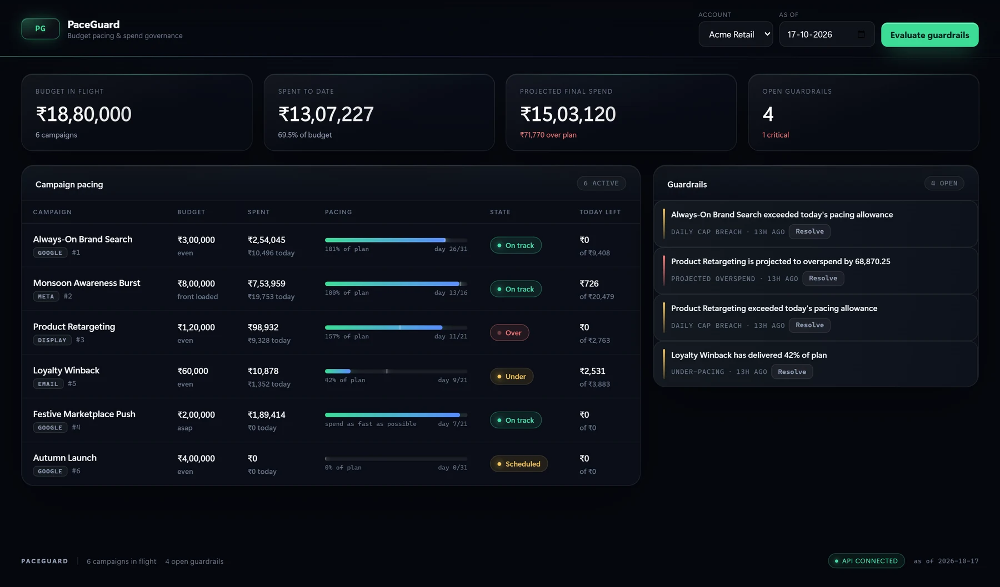
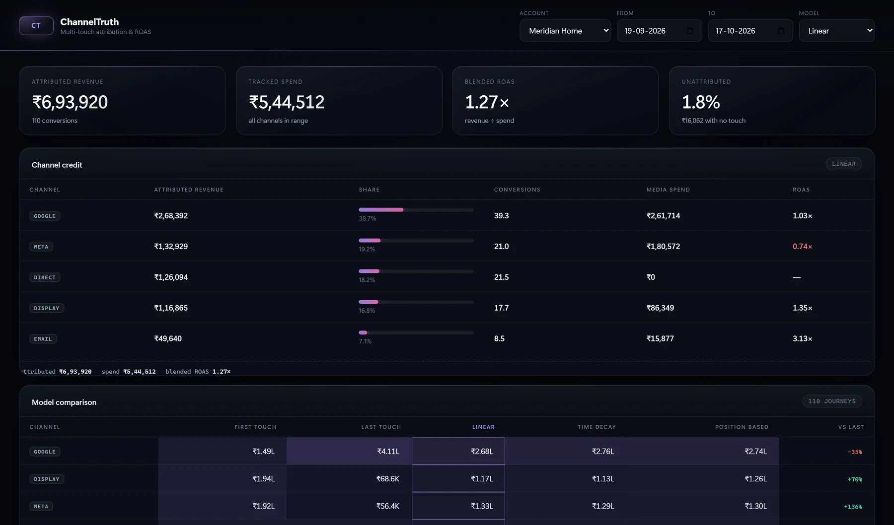
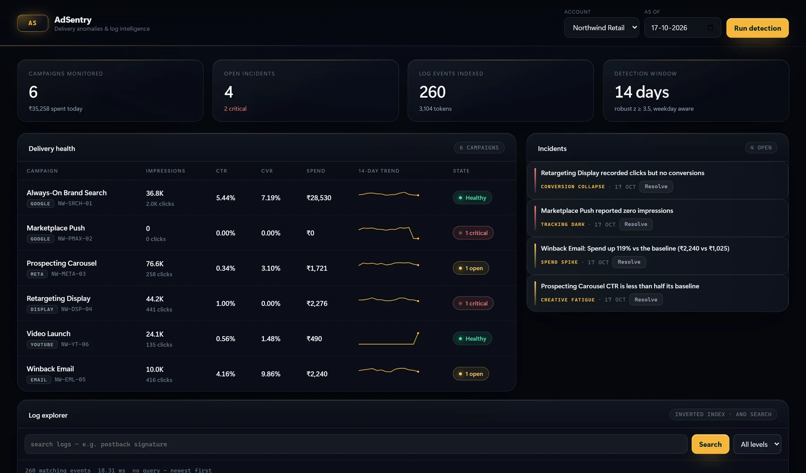

<a href="https://github.com/het12779-ui"></a>

<p align="center"><sub>
<a href="https://github.com/het12779-ui/paceguard">paceguard</a> ·
<a href="https://github.com/het12779-ui/channeltruth">channeltruth</a> ·
<a href="https://github.com/het12779-ui/adsentry">adsentry</a> ·
<a href="https://github.com/het12779-ui/deltax-portfolio">the index</a> ·
<a href="mailto:het12779@gmail.com">mail</a>
</sub></p>

I'm a **computer engineering student**. I build the systems that have to be right about
money, time and blame — then I write down the numbers that prove it. Nine public repos:
three shipped services with **187 passing tests**, one ML team build, and the prototypes
that taught me what the shipped ones do differently.

---

## `$ cat about.txt`

Most student repos stop at the demo. The three services below are built the other way
around: a schema first, then the API, then a UI that reads it, then tests that boot the
real database instead of mocking it. Each one carries its benchmarks in the README, and
each one is honest about the part it does not solve.

I like the unglamorous half of software — idempotent ingest, integer money, tenant
columns in every query — because that is the half that decides whether a number on a
dashboard can be trusted at 2am.

---

## `$ ls -la ~/systems`

<table>
<tr>
<td width="33%" valign="top">
<a href="https://github.com/het12779-ui/paceguard"></a>

<b><a href="https://github.com/het12779-ui/paceguard">paceguard/</a></b><br>
<sub>pacing · projections · guardrails</sub>

**Conclusion:** a campaign that has spent 70% of its budget by day 5 is not "70% done".
Project final spend along that campaign's own curve, alert once, then stop shouting.

<sub>46 tests · 72 ms p50 @ 1,000 campaigns</sub>
</td>
<td width="33%" valign="top">
<a href="https://github.com/het12779-ui/channeltruth"></a>

<b><a href="https://github.com/het12779-ui/channeltruth">channeltruth/</a></b><br>
<sub>5 attribution models · roas</sub>

**Conclusion:** "which channel earned it" is a decision, not a fact. Score the same
journeys five ways at once and show the disagreement instead of hiding it behind one
vendor default.

<sub>102 tests · 0.37 s @ 5,000 journeys</sub>
</td>
<td width="33%" valign="top">
<a href="https://github.com/het12779-ui/adsentry"></a>

<b><a href="https://github.com/het12779-ui/adsentry">adsentry/</a></b><br>
<sub>detection · incidents · log search</sub>

**Conclusion:** detection is cheap, triage is not. Robust z-scores against same-weekday
baselines plus stateful incidents that cannot storm, with the log line that explains the
number in one search.

<sub>39 tests · 246 ms @ 1,000 campaigns</sub>
</td>
</tr>
</table>

<p align="center"><sub>Every screenshot is the seeded demo hitting its own API — no mockups, no Figma.</sub></p>

---

## `$ ./topology --explain`



Three services, one lifecycle: **ingest → model → monitor**. At-least-once in, idempotent
out, evaluation never on the read path. The index repo
[**deltax-portfolio**](https://github.com/het12779-ui/deltax-portfolio) ties them together
with a demo script and a requirement-by-requirement evidence map.

---

## `$ git diff --no-index last_touch first_touch`

<a href="https://github.com/het12779-ui/channeltruth"></a>

The most useful thing ChannelTruth produces is not a number. It is the size of the gap
between two defensible numbers.

---

## `$ ls ~/archive`

The rest of the repos, including the ones that stayed prototypes. A portfolio that hides
those is a brochure, not a record.

| repo | the one-line conclusion | stack | state |
|---|---|---|---|
| [**edulensV2**](https://github.com/het12779-ui/edulensV2) | A PDF becomes a summary, a flashcard deck, a quiz and a concept graph — AI study tools only matter when they point back at the page they read. | React · TypeScript · FastAPI · SQLite · Ollama | active |
| [**AcousticSpace**](https://github.com/het12779-ui/infotact-project-AcousticSpace-Deepfake-Detection) | Synthetic speech leaks the room it was never recorded in: RIR mismatch survives re-encoding, so physics is a better detector than artifacts. | PyTorch · AST · librosa · FastAPI · React | team build · 3★ |
| [**AtmoGraph**](https://github.com/het12779-ui/AtmoGraph-Our-Predictor) | A supply chain is a graph before it is a spreadsheet; ripple effects are a propagation problem, not a forecasting one. | Python · graph · NLP · GNN | team repo · milestone branches |
| [**edulens**](https://github.com/het12779-ui/edulens) | The first attempt: Whisper transcripts plus ChromaDB retrieval for lectures. The pipeline worked; the single-user design did not, and V2 replaced it. | Next.js · FastAPI · Whisper · ChromaDB | prototype · superseded |
| [**deltax-portfolio**](https://github.com/het12779-ui/deltax-portfolio) | The index: three systems, one demo script, evidence mapped requirement by requirement. | Markdown · assets | index |
| [**het12779-ui**](https://github.com/het12779-ui/het12779-ui) | This page. Hand-authored SVG and SMIL, generated from one script, no stat-card services. | SVG · SMIL · Python | you are here |

---

## `$ neofetch --off`



---

## `$ ./bench --all`

| | PaceGuard | ChannelTruth | AdSentry |
|---|---:|---:|---:|
| Tests, real database | **46** | **102** | **39** |
| Endpoint p50 | 72 ms @ 1k campaigns | 0.37 s @ 5k journeys | 246 ms @ 1k campaigns |
| Other measurement | query count constant | totals reconcile across 5 models | 7 ms search @ 20k events |
| Schema | SQL Server DDL, filtered + partial unique indexes | same | same |
| UI | Vue 3, no build step | same | same |
| CI | py3.11 · py3.12 · live smoke | same | same |

Reproduce any row with `make bench` inside the repo. Limits are written into each README
(unpaginated overview, SQLite demo store) rather than rounded away.

---

## `$ cat principles.md`

```py
# 1  tenant isolation is a query property, not a filter
#    account_id is the first argument of every repository call
#    cross-tenant reads return 404 — never confirm another tenant's id
# 2  idempotency lives in the database, because retries are certain
#    tenant-scoped unique constraints, not application-level checks that race
# 3  money is integer minor units, formatted at the edge
#    no float, no SQL MONEY, no rounding in the middle of a calculation
# 4  an alert carries observed, baseline and threshold — or it is noise
#    "clicks dropped 61% vs the last four Mondays" is a diagnosis
# 5  evaluation is never a read-path side effect
#    detection and pacing replay on demand; dashboards stay fast and honest
```

---

## `$ whoami --contact`

```console
het@localhost:~$ curl -s github.com/het12779-ui | jq
{
  "role":       "computer engineering student",
  "location":   "Gandhinagar, India · UTC+5:30",
  "repos":      9,
  "mail":       "het12779@gmail.com",
  "currently":  ["EduLens V2", "learning C#", "reading postmortems"]
}
```

<p>
  <a href="mailto:het12779@gmail.com"></a>
  <a href="https://github.com/het12779-ui?tab=repositories"></a>
</p>

<details>
<summary><code>$ read source.md</code> — how this page is built</summary>

<br>

Every panel above is a single hand-written SVG with SMIL animations: a typed shell
session, a monogram that boots pixel by pixel, packets that travel the topology, bars
that grow once and hold. No badge-only stat cards, no third-party image renderers, no
templates — so the whole profile is one palette and one type scale, and it still animates
inside GitHub's `` sandbox.

The generator ships with this repo: [tools/make_assets.py](https://github.com/het12779-ui/het12779-ui/blob/main/tools/make_assets.py).
Four functions, one palette dict, ~1,200 SVG elements — run it and the panels rebuild
byte for byte.

</details>

```console
het@localhost:~$ exit
logout
# 187 tests · 9 public repos · measured on a laptop, not a slide deck
```
