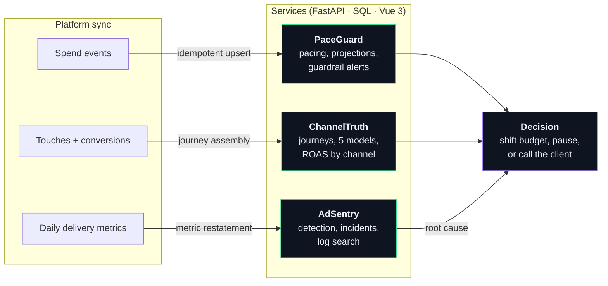

  
  
  

  
  
  
  
  
  

I build the unglamorous layer of advertising software: the part that decides whether
₹3,00,000 of budget lands on schedule, which channel actually earned a conversion, and
whether a campaign broke at 2am while everyone was asleep.

Three services, one lifecycle — **ingest → model → monitor** — each with a real database
schema, a browser UI, tests that touch no mocks, and a CI job that boots the app and
curls it.

---

## Selected work

<table>
<tr>
<td width="33%" valign="top">

<b><a href="https://github.com/het12779-ui/paceguard">PaceGuard</a></b> 
Budget pacing &amp; spend governance

A campaign spending 70% of its budget by day 5 is not "70% done". Projects final spend
along the campaign's own curve and raises guardrail alerts that fire once, not every
hour.

<b>46 tests</b> · 72 ms p50 @ 1,000 campaigns · query count constant
</td>
<td width="33%" valign="top">

<b><a href="https://github.com/het12779-ui/channeltruth">ChannelTruth</a></b> 
Multi-touch attribution &amp; ROAS

The same journeys scored under five models at once — because "which channel gets
credit" is a decision, not a fact. Google reads 1.57× under last-touch and 0.55× under
first-touch; the disagreement is the product.

<b>102 tests</b> · 0.37 s @ 5,000 journeys · identical totals across models
</td>
<td width="33%" valign="top">

<b><a href="https://github.com/het12779-ui/adsentry">AdSentry</a></b> 
Anomaly detection &amp; log search

Robust z-scores against same-weekday baselines, stateful incidents that cannot storm,
and an inverted-index log search in SQL — the "is it broken, and why" layer, without
standing up a second cluster to page about.

<b>39 tests</b> · 246 ms @ 1,000 campaigns · 7 ms search @ 20k events
</td>
</tr>
</table>

Every screenshot is the seeded demo running against its own API — no mockups.

---

## How the three fit together

---

## What I care about in code

**Tenant isolation is a query property, not a filter.** `account_id` is the first argument
of every repository function and appears in every statement. Cross-tenant reads return
**404, not 403** — the API must not confirm that another tenant's id exists. A schema test
fails if a new table forgets the column.

**Idempotency belongs in the database.** At-least-once sync means retries will happen.
Uniqueness lives in tenant-scoped constraints, because application-level checks race.

**Money is integer minor units.** Never `float`, never SQL `MONEY`. Formatting happens at
the edge, after all arithmetic is exact.

**An alert must be explainable to a non-engineer.** Every one carries the observed value,
the baseline and the threshold that fired. "Anomaly detected" is not a diagnosis;
"clicks dropped 61% versus the last four Mondays" is.

**Evaluation is not a read-path side effect.** Detection and pacing run on ingest or an
explicit trigger, never while serving a dashboard, so latency stays predictable and
results are replayable.

---

## Evidence, not adjectives

| | PaceGuard | ChannelTruth | AdSentry |
|---|---:|---:|---:|
| Tests (pytest + BDD, no DB mocks) | 46 | 102 | 39 |
| Endpoint latency, p50 | 72 ms @ 1k campaigns | 0.37 s @ 5k journeys | 246 ms @ 1k campaigns |
| Data model | SQL Server DDL, filtered + partial unique indexes | same | same |
| UI | Vue 3, no build step | same | same |
| CI | Actions: 3.11 + 3.12 + live smoke | same | same |

Benchmarks are reproducible with `make bench` in each repo; the READMEs state the
honest limits (unpaginated overview, SQLite demo store) rather than rounding them away.

---

## Currently

- **Learning C#** — the services here are Python because that is what I could build and
  test end to end. The REST contracts, multi-tenant schema and BDD scenarios port
  directly, and I would rather say that than borrow confidence I have not earned.
- **Reading** production postmortems from ad-tech outages; the failure modes are
  consistently boring (pixels, timezones, retries) and consistently expensive.
- **Open to** Associate Product Engineer / full-stack roles on advertising or data
  platforms.

---

  
  

Built and measured on a laptop, not a slide deck.

